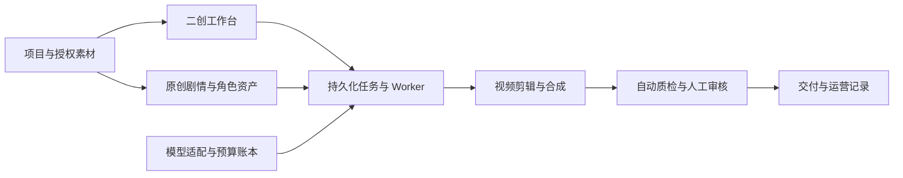

# 架构、产品契约与路线

## 审计基线（2026-10-27）

授权目录 `C:\Users\chejun\Desktop\AI Story` 起始为空，无源码、Git、页面、数据库或既有许可证。此项目为全新独立实现，不存在旧工程可迁移。

工具：Python 3.10.11、Node 20.19.4、npm 10.8.2、Git 2.47.1.windows.2、Docker CLI 28.5.1；FFmpeg/ffprobe 2025-07-17 gyan full build。Docker Linux Engine 初始报 named pipe 不存在；未发现 psql 命令。没有下载 AI 模型或调用付费接口。

## 模块依赖

Vue → 同源 `/api` 代理 → FastAPI → PostgreSQL；Worker 独立进程读取 PostgreSQL 队列 → 本地只读素材 → ffprobe。未来 FFmpeg 输出写独立工作目录、验证完成后原子发布。未来云端模型必须先实现预算预留、调用凭证、未知结果状态与对账，不能照搬 probe 重试。

数据模型：projects、assets、tasks、task_events、cost_entries；正式 Alembic 迁移。资产当前仅初始版本字段，尚无角色/剧本版本链。每个任务保存输入素材引用、参数、输出、错误、尝试次数与事件。

## 分阶段验收与回滚

|阶段|交付与验收|回滚|
|---|---|---|
|P0|工具版本、配置模板、Git、依赖锁定、Compose 配置可解析|停止本项目服务，保留配置和数据；不改系统工具|
|P1|项目/授权素材 API 与 UI、迁移、解析任务、并发领取和幂等、错误重试；真实 PostgreSQL + 视频集成测试、前端构建通过|停 API/Worker，备份数据库和 data；代码退回基线。仅空开发库可 downgrade base|
|P2|裁剪、画幅、字幕、音轨、导出；真实授权视频逐项验证编码与音画|禁用新任务类型，保留原始素材和已导出文件；回退应用版本|
|P3|全局并发上限、心跳、阶段检查点、重启恢复、重复提交和结果未知故障注入|暂停队列，备份；保留事件与调用账本，不自动重放付费请求|
|P4|模型协议、剧本/角色/场景/声音版本链；无付费适配器契约测试与授权接入验收|关闭模型适配器，保留版本历史|
|P5|图片/视频生成、跨镜头一致性与单集预算验证；用户另行授权付费调用|关闭供应商，保留调用 ID、成本和素材|
|P6|黑帧/音频/字幕/格式质检、人工审核、交付包、备份恢复演练|保留报告与交付版本，回退应用；运营仅记录和导入，不自动发布|

当前首页六个工作区对应产品导航；资产与批量生产有真实 API，其余明确标为未实现。八个逻辑模块中的剪辑、质检、模型成本将在后续扩展独立工作区，不把入口存在视为完成。

主要技术债：数据库与文件写入跨资源一致性、分页、磁盘配额、自动备份、全局并发限制、结构化服务日志、浏览器自动化、配置热检查、角色/剧情版本、预算策略尚未完成。

## P2 增量实现

复用 assets/tasks/task_events 与原有 Worker，增加迁移 0002（阶段、进度、取消、执行令牌、开始/结束时间、耗时、输入快照）。新增 `render.py` 统一参数验证/FFmpeg 处理/输出验证，`process_guard.py` 提供 Windows 子进程生命周期保护。全局 advisory lock 将并发限制为 1；状态写回必须持有当前 worker_token。输入资产 ID、存储键与哈希存为快照，参数完整入库。

发布协议：独立尝试临时目录 → FFmpeg → ffprobe 校验 → 持久清单 → no-clobber 硬链接发布 → 数据库成功。崩溃后依据输入/参数签名及输出验证进行对账，已有成片不覆盖。数据库与文件系统仍不是分布式事务；错误或中断保留日志、孤立临时文件，后续可增加回收与配额。

前端保持原 Vue 工作区，新增 VideoEditor 参数表单；任务区控制与成片区使用同一 API 状态。P2 未新增第三方依赖；浏览器验收用本机 Chrome CDP 与 Node 原生 WebSocket。详细证据见 P2_ACCEPTANCE.md。

## P3 增量实现

数据库新增batches、queue_control、worker_nodes、task_attempts。批次幂等请求与全部任务在同一事务中提交；旧单任务入口保留。独立心跳线程续租，advisory lock之外再以有效运行租约约束领取。错误分类决定有限退避或人工修复；每次尝试独立保存参数、输入、检查点、耗时、输出与错误。

编码完成检查点以原子JSON和SHA-256记录，重试复用前核验输入、参数、哈希和媒体信息；最终成片发布仍使用不覆盖的同卷链接。成本统计按币种分开，只统计实际入账记录。当前没有付费调用或预算预留执行入口。

前端批量生产区新增真实队列控制、Worker心跳、尝试详情和日志尾部。P3仍无新增第三方运行依赖。详细证据与边界见P3_ACCEPTANCE.md。

## P4 创作资产基础

story_entities保存稳定身份，story_versions追加不可变内容，story_references固定具体版本/原始素材，story_operations记录幂等规则操作。编辑采用行锁与期望版本，恢复追加新版本，任务通过story_version_id指向明确依据；P3未带该字段的请求重试保持兼容。

本地规则操作只整理/拆分文本。统一ModelAdapter契约当前仅有DisabledAdapter，估价未知、调用直接拒绝，没有供应商网络执行路径。模型计划与生成结果明确区分。

新前端StoryStudio提供实体编辑、版本历史、对比、恢复、缓存草稿和生产引用；目录/历史默认元数据，正文按版本加载。创作包导出递归包含当前资产固定依赖与素材授权清单。详见P4_ACCEPTANCE.md。
