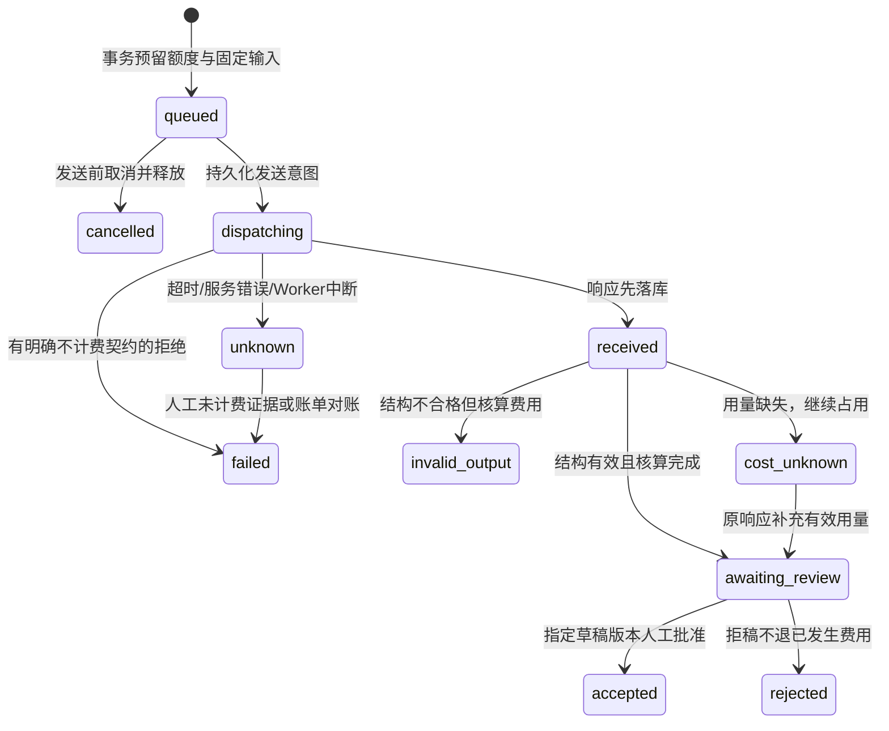

# P5 文本模型与预算契约

本阶段用户授权：真实调用预算 **0 元**，只进行离线模拟、进程恢复和本机 HTTP 验收。真实剧情创作质量、供应商可达性和账单准确性均未验收。图片、视频、TTS 不接入。

## 已核对的官方协议

开发时核对 OpenAI 官方文档：

- [Chat Completions 创建请求与响应](https://developers.openai.com/api/reference/python/resources/chat/subresources/completions/methods/create)
- [结构化输出与拒绝响应](https://developers.openai.com/api/docs/guides/structured-outputs)
- [错误码和限流](https://developers.openai.com/api/docs/guides/error-codes)

实现采用现有 httpx，不新增 SDK。业务通过统一适配器调用，供应商、模型及价格不写死。兼容接口为 `POST <base_url>/chat/completions`，传入 model、system/user messages、JSON schema 或 JSON object 格式、单结果、非流式、`store:false`。输出限制参数可配置为 `max_completion_tokens` 或旧兼容端点的 `max_tokens`；必须确认该模型限制包含全部计费输出（含推理 Token）。不同兼容供应商可能不支持这些字段，实际兼容性待授权后验收。

只解析必要的响应 ID、文本、完成原因和 usage。缺失有效用量保留预算占用；refusal、length、无效 JSON、错误结构均不得直接进入正式版本。输入/输出 Token 分别保存，缓存和推理细项仅作记录、不重复加价。没有确认缓存折扣时用最高输入费率保守核算。供应商原始错误正文、请求头和密钥不写入日志或返回前端。

## 调用、预算与恢复

金额均为整数 micros（1 单位货币 = 1,000,000 micros），CNY/USD 分开，无汇率换算。费率为可空十进制数，每百万 Token 计价。

预留 = 向上取整（已核验的最大输入 Token × 输入费率 + 输出上限 × 输出费率）。整个输入上限被预留，并非对当前小说的精确估价。提交时使用 UTF-8 字节数加保守协议余量检查输入；这不是精确 tokenizer，要求后续核验供应商计费上界。输入上限过小会拒绝，长小说应选择较小固定分集。当前不自动跨请求切块。

价格未知时 `upper_bound_micros` 为 null，禁止调用。核算费率与用量得到 `calculated_cost_micros`，不是供应商账单；`actual_cost_micros` 在未登记人工账单凭证时为 null。模拟费用只进入模拟账户，绝不写入真实 `cost_entries`。同一调用可登记一张实付凭证，多张幂等退款凭证，退款总额不能超过实付；实际费用为凭证净额，未接入供应商账单自动核验。

同一项目请求键唯一，同键不同请求返回409。前端当前标签页保存请求键，重复提交同参数返回原调用；主动“开始新改编请求”才重置。浏览器缓存不可用会明确报错，不能绕过幂等。新标签页/直接 API 调用者须自行保留请求键。

每个逻辑调用最多自动发送一次；`X-Client-Request-Id` 仅供关联，不假定供应商提供幂等扣费。发送意图落库后中断，即使实际上尚未到达网络，也按结果未知处理。不得盲目重发或直接释放。已保存响应可以自动或手动恢复本地结算，不再次生成。已确定失败/无效输出/取消且账目明确后，可经受控重试创建新调用、新额度占用；发送过的请求必须确认潜在新收费。

429 仅在已核验“不受理不计费”契约时释放，否则未知；5xx、连接/读写超时、畸形 HTTP 响应等均按未知处理。HTTPX 无自动重试、不使用系统代理、不跟随重定向，TLS 验证开启。配置超时为连接/网络读写超时，不是供应商生成终止保证。发送后取消只停止后续采用，无法保证远端不生成或不收费；响应最终按用量结算。

项目账户行锁控制并发预留；全机跨项目真实预算由 PostgreSQL 事务 advisory lock 序列化。排队时与发送前均检查授权和本机总限额。超上界/超预算记录核算并冻结账户，阻止后续调用。账户冻结不能靠提高额度直接解除，目前需人工核查及后续治理操作，不提供自动解除。供应商不遵守声明的上界、额外工具/存储费用等无法由客户端事后消除，真实接入须禁止未计价能力并配置供应商侧硬额度。

## 版本与人工审核

输入固定到 `story_versions.id`，保存提示词版本、完整提示词、供应商费率快照、请求参数、调用 ID 和用量。源版本不可变。

模型输出先保存在 `model_calls` 和不可变 `model_drafts`，不创建正式 StoryVersion。人工修改、历史加载后保存均追加草稿修订；审核绑定具体修订号，过期审核冲突。默认批准创建独立正式剧本和分集大纲，记录来源/模型/模拟标记/审核信息；API 也支持追加源剧本，但源固定版本仍须为当前版本。小说/分集必须另建剧本。正式版本可沿用 P4 比较与追加回滚。对白保存在调用草稿与审核记录中；不会自动转成 TTS。

## 供应商选择与后续实际接入

建议优先选择有正式文档、JSON 结构化输出、明确输入/输出/推理 Token 上限、用量响应和账单查询、账户硬额度且商用/数据保留条款可接受的官方文本接口。OpenAI 官方端点可作协议基准；其他兼容供应商需逐项核实，不能仅凭“兼容”标签认定价格或计费语义相同。当前没有指定或推荐某个未经核验的模型价格。

接入顺序：

1. 用户选定供应商与模型，核实价目表、币种、地区可用性、授权素材外发与保留政策、上下文和全部计费 Token 上限。预计真实费用目前为 **未知/null**，不能用模拟单价当报价。
2. 在剧情改编中保存真实配置（默认禁用）：HTTPS Base URL、模型、密钥环境变量**名称**、已核验费率、价格来源、上下界、结构化输出和限制参数。密钥值只设在本机进程环境或忽略的 `.env`，不要发到聊天。
3. 用户另行明确授权本次发送素材和费用上限。然后在本机设置 `AI_STORY_ENABLE_PAID_TEXT=1`、`AI_STORY_BUDGET_GUARD_APPROVED=1`、唯一 `AI_STORY_LIVE_AUTHORIZATION_ID`，绑定 `AI_STORY_LIVE_BASE_URL` 和 `AI_STORY_LIVE_SECRET_ENV`；设置对应币种 `AI_STORY_LIVE_LIMIT_*_MICROS`。其余币种保持0。重启 API 与 Worker。
4. 通过 `/docs` 的 `/api/text/providers/{id}/availability` 启用该配置；用 `/api/text/projects/{id}/budgets` 配置正数 live 限额和匹配 authorization_id、幂等键。该阶段 UI 不提供提高真实额度的按钮。环境开关、端点绑定、密钥、项目授权、可靠费率、本机限额任一缺失都会阻止发送。
5. 先获取 quote，确认预留上限与供应商侧硬限额，再提交一次小文本。核对请求 ID、用量、人工账单与创作质量；登记凭证。未执行这些步骤前不能标记真实 AI 验收通过。

关闭调用：禁用供应商、将本机开关置0并重启 API/Worker；有占用的项目额度不能直接降到占用以下，不删除账本。已发出请求仍需对账。
